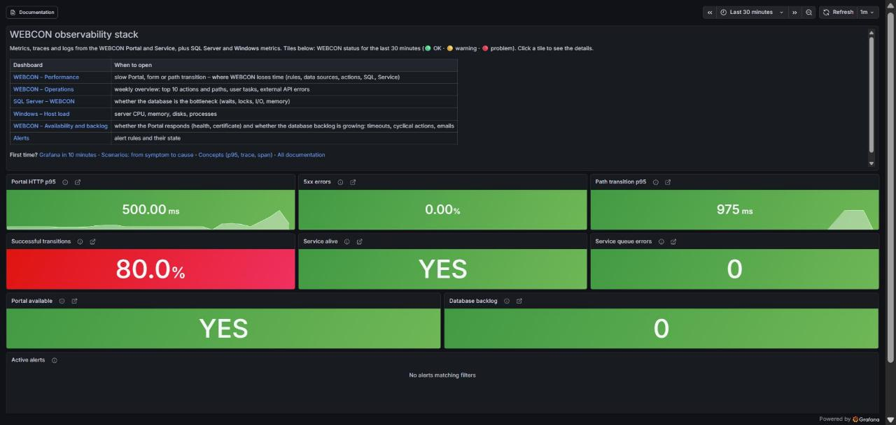

# Grafana in 10 minutes

This chapter is for people who know WEBCON but have never used Grafana. After reading it, you will be able to open a dashboard, set the time range, filter the data, and go from a chart to the details of a single operation.

## Sign-in and navigation

1. Open Grafana – on the server <http://localhost:3000>, from another computer the address provided by your administrator (e.g. `http://server:3000`).
2. Sign in with the account provided by your administrator (the *Viewer* role is enough for viewing).
3. After signing in, you will see the **Start** screen (home dashboard, house icon): WEBCON status for the last 30 minutes in eight tiles, links to dashboards and documentation, and a list of active alerts. Clicking a tile opens “WEBCON – Performance”.

   

   In the screenshot: Portal without traffic (gray / green tiles), **Service alive = NO**, and an active alert *W4 No Service heartbeat* – the WEBCON WorkFlow Service was running, but after the virtual machine was paused it stopped executing its work loop; fix: restart the `WebCon WorkFlow Service` service.
4. All dashboards: menu (☰, top left corner) → **Dashboards**. They are organized in folders:

| Folder | Dashboard | Question it answers |
|---|---|---|
| `webcon` | [WEBCON – Performance](03-webcon-performance.md) | What is happening **now**, and where does the application lose time? |
| `webcon` | [WEBCON – Operations](04-webcon-operations.md) | What did the **last week** look like? Which actions and paths are the slowest, who has the most tasks, are external APIs working? |
| `webcon` | [WEBCON – Availability and backlog](09-availability-and-backlog.md) | Is the Portal responding, and is work piling up in the content database (timeouts, cyclical actions, emails)? |
| `sql` | [SQL Server – WEBCON](05-sql-server.md) | Is the database a bottleneck? |
| `host` | [Windows – Host load](06-windows-host.md) | Is the server short on CPU, memory, disk? |
| `dotnet` | ASP.NET Core | technical details of the Portal (Grafana community dashboards) |

Each dashboard has links to the others in the top right corner (the time range is carried over with the link) and a **Documentation** link to the description of its panels.

Start with **WEBCON – Performance**; a guide from symptom to cause: [Scenarios](08-scenarios.md).

## Screen elements

```
┌──────────────────────────────────────────────────────────────────────────────────┐
│ Dashboards › webcon › WEBCON – Performance     [⏱ Last 6 hours ▾] [⟳ 1m ▾]  🔗 │  ← time range, refresh, links
│ Service [All ▾]   Database (DB ID) [All ▾]                                       │  ← variables (filters)
├──────────────────────────────────────────────────────────────────────────────────┤
│ ▾ Status                                                                         │  ← row (click to collapse/expand)
│ ┌────────┐┌────────┐┌────────┐ ...                                               │
│ │ 12 req/s││ 0.8 s  ││ 0.2 %  │                                                  │  ← tiles (stat)
│ └────────┘└────────┘└────────┘                                                   │
│ ▸ Portal – user experience                                                       │  ← collapsed row
└──────────────────────────────────────────────────────────────────────────────────┘
```

### Time range (top right corner)

- Click the clock (e.g. **Last 6 hours**) and select a range or enter your own (`now-2d` → `now`, or specific dates).
- **Zooming in:** select a part of a chart with the mouse (drag horizontally) – the whole dashboard switches to that range. To go back: the **⟵** button (*Zoom out*) or select the range again.
- “Dashboard time range” tiles (e.g. *Successful transitions*, *Service queue errors*) count over **the entire selected range** – their value changes when you change the range.
- The **⟳** arrow next to the clock refreshes the data; the drop-down list sets automatic refresh.

> Time in Grafana is shown in your browser's time zone. Daily charts on the “WEBCON – Operations” dashboard count UTC days.

### Variables (filters at the top)

The drop-down lists below the title filter all panels at once, e.g.:

| Dashboard | Variable | Meaning |
|---|---|---|
| WEBCON – Performance / Operations | **Service** | `Portal` (web application), `WebCon.WorkFlow` (WEBCON WorkFlow Service), or both |
| WEBCON – Performance | **Database (DB ID)** | WEBCON content database (installation with several content databases) |
| Windows – Host load | **Host**, **Processes** | the server and the processes shown on the process charts |
| SQL Server | **Databases** | databases on the per-database charts |

### Panels

| Type | Appearance | How to read it |
|---|---|---|
| **Tile (stat)** | large number, background color | **green** = OK, **yellow / orange** = warning, **red** = problem. Color thresholds are described for each dashboard |
| **Line chart** | lines over time | hover to see the values at a point; click a name in the legend to show only that series (Ctrl+click = add another one). Wider charts show mean / max / last values in the legend; narrow charts (three in a line) show only the series names – the values are in the tooltip |
| **Heatmap** | colored rectangles | vertical axis = duration, color = how many operations took that long at a given moment; a bright cell high up = many slow operations |
| **Table** | rows and columns | click a header to sort; blue (underlined) values are **links** – usually to traces |
| **Logs** | list of records | click a record to expand its details (fields, `trace_id`) |

Each panel has an **ⓘ** icon in its header (panel description – what it shows and how to read it) and a **⋮** menu:
- **View** (`v` key) – panel in full screen,
- **Explore** – opens the panel query in exploration mode (for advanced users),
- **Inspect → Data** – panel data in a table, with the option to download a CSV.

“No data” in a panel usually means that the event has not occurred (e.g. *Service queue errors* appear only after the first error), not a failure.

## Three kinds of data

The stack collects three kinds of information about WEBCON – and lets you move between them:

| Kind | What it is | WEBCON example | Where |
|---|---|---|---|
| **Metrics** | numbers collected every minute: how many, how fast, how much | 12 path transitions /min, Portal response time p95 0.8 s | charts and tiles |
| **Traces** | the course of **a single** operation step by step, with durations | form open: model 120 ms, rules 340 ms, REST data source 2.1 s, SQL 80 ms | “Where the time goes” tables, trace view |
| **Logs** | messages written by WEBCON | `Error getting data for DataSource name: Exchange rates ID: 58` | log panels |

Details of the concepts: [Concepts](02-concepts.md).

## Drilling down: from chart to root cause

This is the most important skill. A typical path:

```
red tile ─► chart (when?) ─► exemplar point or table (which operation?) ─► trace (which step?) ─► logs (what error?)
```

### 1. Exemplar – from a chart to a trace

On duration charts (e.g. *Portal response time*, *Path transition time*) you can see small **points (diamonds)** – these are **exemplars**: sample individual requests from a given moment. Hover over a point high on the chart (a slow request) and click **Query with Tempo** / **View trace** – the trace of that request opens.

### 2. Table – from a ranking to traces

In the “Where the time goes” tables (paths, rules, data sources, actions), click an **identifier** (e.g. a path ID) – a list of traces in which this operation occurred opens. Select a trace (e.g. the longest one).

### 3. Trace view

```
Portal: GET /api/nav/db/1/app/5/element/1234/form          2.8 s ████████████████████████████
  webcon.elements_management.element.model.load            2.5 s   ██████████████████████████
    webcon.rule.execute (rule.id = 18)                     0.3 s     ███
    webcon.data_source.data.load (data_source.id = 58)     2.1 s        █████████████████████
      HTTP GET api.nbp.pl                                  2.1 s        █████████████████████
    SELECT [WFElements]                                    0.05 s                           █
```

- Each row is a **span** – one step of the operation; indentation = a step inside the parent step.
- Bar length = duration. Look for the longest bar **deepest** in the tree – it is usually the cause (here: data source 58 calling an external API).
- Click a span to see its **attributes**: `webcon.rule.id`, `webcon.data_source.id`, `webcon.path.id`, `webcon.user.login`, `http.route`, `db.query.text` (SQL query text), etc. The identifiers correspond to the IDs in WEBCON Designer Studio.
- A red marker next to a span = error (e.g. HTTP 500 from an external API).

### 4. From a trace to logs and from logs to a trace

- In the trace view, the **logs** icon next to a span (*Logs for this span*) shows WEBCON logs with the same `trace_id`.
- In a log panel, expand a record – the **Open trace** button next to the `trace_id` field opens the trace in which the log was written.

## Explore – your own questions (optional)

Menu → **Explore** is a free-form query mode. Useful even without knowing the query languages:

- **Tempo → Search**: filter by service name (`Portal`), span name, duration (`> 2s`) – a list of traces.
- **Loki → Label browser / builder**: select `service_name = Portal`, level `error` – a list of errors.
- Sample TraceQL queries (Tempo):

  ```
  { name = "webcon.data_source.data.load" && span.webcon.data_source.id = 58 }      # calls of data source 58
  { name = "webcon.elements_management.path.transitions" && duration > 5s }          # path transitions longer than 5 s
  { span.webcon.user.login =~ ".*smith.*" && kind = server }                         # requests of a user
  ```

  IDs in WEBCON are numbers – in TraceQL, use them without quotes.

## What Grafana does not do here

- Dashboards are **read-only**: changes to dashboards in the `webcon`, `sql`, `host` folders are lost when the stack is upgraded. For your own dashboard: *Save as* a new one.
- Alerts do not send emails or messages – they are visible only in Grafana: [Alerts](07-alerts.md).
