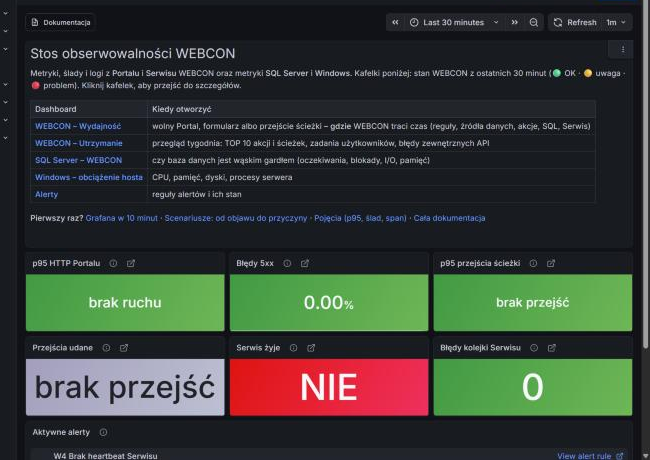

# Grafana w 10 minut

Ten rozdział jest dla osób, które znają WEBCON, ale nigdy nie używały Grafany. Po nim będziesz umieć otworzyć dashboard, ustawić zakres czasu, przefiltrować dane i przejść od wykresu do szczegółów pojedynczej operacji.

## Logowanie i nawigacja

1. Otwórz Grafanę – na serwerze <http://localhost:3000>, z innego komputera adres podany przez administratora (np. `http://serwer:3000`).
2. Zaloguj się kontem od administratora (rola *Viewer* wystarcza do oglądania).
3. Po zalogowaniu zobaczysz ekran **Start** (dashboard domowy, ikona domku): stan WEBCON z ostatnich 30 minut w sześciu kafelkach, odnośniki do dashboardów i dokumentacji oraz listę aktywnych alertów. Kliknięcie kafelka otwiera „WEBCON – Wydajność”.

   

   Na zrzucie: Portal bez ruchu (szare / zielone kafelki), **Serwis żyje = NIE** i aktywny alert *W4 Brak heartbeat Serwisu* – Serwis WEBCON działał, ale po wstrzymaniu maszyny wirtualnej przestał wykonywać swoją pętlę pracy; naprawa: restart usługi `WebCon WorkFlow Service`.
4. Wszystkie dashboardy: menu (☰, lewy górny róg) → **Dashboards**. Są w folderach:

| Folder | Dashboard | Pytanie, na które odpowiada |
|---|---|---|
| `webcon` | [WEBCON – Wydajność](03-webcon-wydajnosc.md) | Co dzieje się **teraz** i gdzie aplikacja traci czas? |
| `webcon` | [WEBCON – Utrzymanie](04-webcon-utrzymanie.md) | Jak wyglądał **ostatni tydzień**? Które akcje i ścieżki są najwolniejsze, kto ma najwięcej zadań, czy zewnętrzne API działają? |
| `sql` | [SQL Server – WEBCON](05-sql-server.md) | Czy baza danych jest wąskim gardłem? |
| `host` | [Windows – obciążenie hosta](06-host-windows.md) | Czy serwerowi brakuje CPU, pamięci, dysku? |
| `dotnet` | ASP.NET Core | szczegóły techniczne Portalu (dashboardy społeczności Grafana) |

Każdy dashboard ma w prawym górnym rogu linki do pozostałych (zakres czasu przechodzi razem z linkiem) i link **Dokumentacja** do opisu jego paneli.

Zacznij od **WEBCON – Wydajność**; przewodnik od objawu do przyczyny: [Scenariusze](08-scenariusze.md).

## Elementy ekranu

```
┌──────────────────────────────────────────────────────────────────────────────────┐
│ Dashboards › webcon › WEBCON – Wydajność       [⏱ Last 6 hours ▾] [⟳ 1m ▾]  🔗 │  ← zakres czasu, odświeżanie, linki
│ Usługa [All ▾]   Baza (DB ID) [All ▾]                                            │  ← zmienne (filtry)
├──────────────────────────────────────────────────────────────────────────────────┤
│ ▾ Stan                                                                           │  ← rząd (kliknij, by zwinąć/rozwinąć)
│ ┌────────┐┌────────┐┌────────┐ ...                                               │
│ │ 12 req/s││ 0,8 s  ││ 0,2 %  │                                                  │  ← kafelki (stat)
│ └────────┘└────────┘└────────┘                                                   │
│ ▸ Portal – doświadczenie użytkownika                                             │  ← zwinięty rząd
└──────────────────────────────────────────────────────────────────────────────────┘
```

### Zakres czasu (prawy górny róg)

- Kliknij zegar (np. **Last 6 hours**) i wybierz zakres albo wpisz własny (`now-2d` → `now`, albo konkretne daty).
- **Przybliżanie:** zaznacz myszą fragment wykresu (przeciągnij w poziomie) – cały dashboard przełączy się na ten zakres. Powrót: przycisk **⟵** (*Zoom out*) albo ponownie wybierz zakres.
- Kafelki typu „w zakresie dashboardu” (np. *Przejścia udane*, *Błędy kolejki Serwisu*) liczą **cały wybrany zakres** – po zmianie zakresu zmienia się ich wartość.
- Strzałka **⟳** obok zegara odświeża dane; rozwijana lista ustawia automatyczne odświeżanie.

> Czas w Grafanie jest w strefie Twojej przeglądarki. Wykresy dzienne na dashboardzie „Utrzymanie” liczą doby UTC.

### Zmienne (filtry na górze)

Rozwijane listy pod tytułem filtrują wszystkie panele naraz, np.:

| Dashboard | Zmienna | Znaczenie |
|---|---|---|
| WEBCON – Wydajność / Utrzymanie | **Usługa** | `Portal` (strona WWW), `WebCon.WorkFlow` (Serwis WEBCON) albo oba |
| WEBCON – Wydajność | **Baza (DB ID)** | baza treści WEBCON (instalacja z kilkoma bazami treści) |
| Windows – obciążenie hosta | **Host**, **Procesy** | serwer i procesy widoczne na wykresach procesów |
| SQL Server | **Bazy** | bazy danych na wykresach per baza |

### Panele

| Typ | Wygląd | Jak czytać |
|---|---|---|
| **Kafelek (stat)** | duża liczba, kolor tła | **zielony** = OK, **żółty / pomarańczowy** = uwaga, **czerwony** = problem. Progi kolorów są opisane przy każdym dashboardzie |
| **Wykres liniowy** | linie w czasie | najedź myszą, by zobaczyć wartości w punkcie; kliknij nazwę w legendzie, by pokazać tylko tę serię (Ctrl+klik = dodaj kolejną) |
| **Heatmapa** | kolorowe prostokąty | oś pionowa = czas trwania, kolor = ile operacji trwało tyle w danym momencie; jasne pole wysoko = wiele wolnych operacji |
| **Tabela** | wiersze i kolumny | kliknij nagłówek, by sortować; niebieskie (podkreślone) wartości są **linkami** – zwykle do śladów |
| **Logi** | lista rekordów | kliknij rekord, by rozwinąć szczegóły (pola, `trace_id`) |

Każdy panel ma w nagłówku ikonę **ⓘ** (opis panelu – co pokazuje i jak go czytać) oraz menu **⋮**:
- **View** (klawisz `v`) – panel na cały ekran,
- **Explore** – otwiera zapytanie panelu w trybie eksploracji (dla zaawansowanych),
- **Inspect → Data** – dane panelu w tabeli, z możliwością pobrania CSV.

„No data” w panelu zwykle oznacza, że zdarzenie nie wystąpiło (np. *Błędy kolejki Serwisu* pojawiają się dopiero po pierwszym błędzie), a nie awarię.

## Trzy rodzaje danych

Stos zbiera trzy rodzaje informacji o WEBCON – i pozwala przechodzić między nimi:

| Rodzaj | Co to jest | Przykład z WEBCON | Gdzie |
|---|---|---|---|
| **Metryki** | liczby zbierane co minutę: ile, jak szybko, jak dużo | 12 przejść ścieżek / min, p95 czasu odpowiedzi Portalu 0,8 s | wykresy i kafelki |
| **Ślady** (traces) | przebieg **jednej** operacji krok po kroku z czasami | otwarcie formularza: model 120 ms, reguły 340 ms, źródło danych REST 2,1 s, SQL 80 ms | tabele „Gdzie ucieka czas”, widok śladu |
| **Logi** | komunikaty zapisywane przez WEBCON | `Error getting data for DataSource name: Kursy walut ID: 58` | panele logów |

Szczegóły pojęć: [Pojęcia](02-pojecia.md).

## Drążenie: od wykresu do przyczyny

To najważniejsza umiejętność. Typowa ścieżka:

```
kafelek na czerwono ─► wykres (kiedy?) ─► punkt-exemplar albo tabela (która operacja?) ─► ślad (który krok?) ─► logi (jaki błąd?)
```

### 1. Exemplar – z wykresu do śladu

Na wykresach czasu (np. *Czas odpowiedzi Portalu*, *Czas przejścia ścieżki*) widać małe **punkty (romby)** – to **exemplary**: przykładowe pojedyncze żądania z danego momentu. Najedź na punkt wysoko na wykresie (wolne żądanie) i kliknij **Query with Tempo** / **View trace** – otworzy się ślad tego żądania.

### 2. Tabela – z rankingu do śladów

W tabelach „Gdzie ucieka czas” (ścieżki, reguły, źródła danych, akcje) kliknij **identyfikator** (np. ID ścieżki) – otworzy się lista śladów, w których wystąpiła ta operacja. Wybierz ślad (np. najdłuższy).

### 3. Widok śladu

```
Portal: GET /api/nav/db/1/app/5/element/1234/form          2,8 s ████████████████████████████
  webcon.elements_management.element.model.load            2,5 s   ██████████████████████████
    webcon.rule.execute (rule.id = 18)                     0,3 s     ███
    webcon.data_source.data.load (data_source.id = 58)     2,1 s        █████████████████████
      HTTP GET api.nbp.pl                                  2,1 s        █████████████████████
    SELECT [WFElements]                                    0,05 s                           █
```

- Każdy wiersz to **span** – jeden krok operacji; wcięcie = krok wewnątrz kroku nadrzędnego.
- Długość paska = czas trwania. Szukaj najdłuższego paska **najgłębiej** w drzewie – to zwykle przyczyna (tu: źródło danych 58 wołające zewnętrzne API).
- Kliknij span, aby zobaczyć **atrybuty**: `webcon.rule.id`, `webcon.data_source.id`, `webcon.path.id`, `webcon.user.login`, `http.route`, `db.query.text` (tekst zapytania SQL) itd. Identyfikatory odpowiadają ID w WEBCON Designer Studio.
- Czerwony znacznik przy spanie = błąd (np. HTTP 500 z zewnętrznego API).

### 4. Ze śladu do logów i z logów do śladu

- W widoku śladu ikona **logów** przy spanie (*Logs for this span*) pokazuje logi WEBCON z tym samym `trace_id`.
- W panelu logów rozwiń rekord – przycisk **Otwórz ślad** przy polu `trace_id` otwiera ślad, w którym zapisano log.

## Explore – własne pytania (dla chętnych)

Menu → **Explore** to tryb swobodnych zapytań. Przydatne bez znajomości języków zapytań:

- **Tempo → Search**: filtr po nazwie usługi (`Portal`), nazwie spanu, czasie trwania (`> 2s`) – lista śladów.
- **Loki → Label browser / builder**: wybierz `service_name = Portal`, poziom `error` – lista błędów.
- Przykładowe zapytania TraceQL (Tempo):

  ```
  { name = "webcon.data_source.data.load" && span.webcon.data_source.id = 58 }      # wywołania źródła danych 58
  { name = "webcon.elements_management.path.transitions" && duration > 5s }          # przejścia ścieżek dłuższe niż 5 s
  { span.webcon.user.login =~ ".*kowalski.*" && kind = server }                      # żądania użytkownika
  ```

  ID w WEBCON są liczbami – w TraceQL bez cudzysłowów.

## Czego Grafana tu nie robi

- Dashboardy są **tylko do odczytu**: zmiany na dashboardach z folderów `webcon`, `sql`, `host` znikną przy aktualizacji stosu. Własny dashboard: *Save as* jako nowy.
- Alerty nie wysyłają e-maili ani wiadomości – są widoczne tylko w Grafanie: [Alerty](07-alerty.md).
